<div align="center">




<p>
  
  
  
  <a href="https://github.com/jf-floresriera/flutter_demo/actions/workflows/build-apk.yml"></a>
</p>

</div>


# ¿Qué es esto?

Un **Hola Mundo en Flutter** pensado para explicar, en vivo, todo lo que hace falta para pasar de
una línea de código Dart a una aplicación instalada en un teléfono Android.

La app es deliberadamente pequeña — un `StatelessWidget`, un `StatefulWidget`, un `setState` y
una prueba — porque el objetivo no es la app, sino el **camino**: instalar, crear, ejecutar,
recargar en caliente, probar, compilar y desplegar.

Hace parte de la exposición *Dart y Flutter* del curso de Desarrollo de Aplicaciones Móviles,
Universidad Nacional de Colombia.


# Estructura del proyecto

```text
flutter_demo/
├── lib/
│   └── main.dart              ← TODA la app: widgets, estado y tema
├── test/
│   └── widget_test.dart       ← prueba que toca el botón sin emulador
├── android/                   ← proyecto Android "anfitrión" (Gradle + 1 Activity)
│   └── app/src/main/
│       ├── AndroidManifest.xml
│       └── java/.../MainActivity.java   ← la única Activity: Flutter dibuja dentro
├── pubspec.yaml               ← nombre, versión y dependencias (como build.gradle)
├── analysis_options.yaml      ← reglas de estilo (flutter analyze)
└── .github/workflows/
    └── build-apk.yml          ← compila el APK en la nube en cada push
```

| En Android nativo (Kotlin) | En Flutter (Dart) |
|---|---|
| `build.gradle` | `pubspec.yaml` |
| Activity + layout XML | `Widget` con su método `build()` |
| `ViewModel` + `LiveData` / `StateFlow` | `State` + `setState()` (o Riverpod / Provider en apps grandes) |
| `RecyclerView` + `Adapter` | `ListView.builder` |
| Material Components | `MaterialApp`, `Scaffold`, `AppBar`, `Card`… ya incluidos |
| Ejecutar → recompilar | **Hot reload**: el cambio aparece en menos de un segundo |


# 1. Instalación (una sola vez)

### Flutter SDK

**Windows:** descargar el SDK desde la página oficial de Flutter, descomprimirlo en
`C:\src\flutter` (nunca en `Archivos de programa`) y agregar `C:\src\flutter\bin` al `PATH`.

**Linux:**

```bash
git clone https://github.com/flutter/flutter.git -b stable ~/flutter
echo 'export PATH="$PATH:$HOME/flutter/bin"' >> ~/.bashrc
source ~/.bashrc
```

### Android Studio

1. Instalar la versión **actual** desde developer.android.com/studio.
2. **Settings → Plugins → Marketplace**: instalar **Flutter** (instala **Dart** con él).
3. **Settings → Languages & Frameworks → Flutter**: apuntar al SDK.
4. **Settings → Languages & Frameworks → Android SDK → SDK Tools**: marcar
   **Android SDK Command-line Tools**.

### Verificar

```bash
flutter doctor --android-licenses   # aceptar todas
flutter doctor                      # todo en [✓] antes de seguir
```


# 2. Ejecutar

```bash
git clone https://github.com/jf-floresriera/flutter_demo.git
cd flutter_demo
flutter pub get
flutter run
```

**Desde Android Studio:** *File → Open* → carpeta `flutter_demo` → elegir el emulador en la lista
de dispositivos → **Run ▶**.

**Emulador:** *Tools → Device Manager → Create Device* (cualquier Pixel reciente).

**Celular físico:** activar *Opciones de desarrollador → Depuración USB*, conectar por cable y
confirmar con `flutter devices`.

### Hot reload

Con la app corriendo, cambie un texto en `lib/main.dart` y guarde (**Ctrl + S**). El cambio
aparece en el teléfono **sin perder el estado** — el contador de saludos se conserva.

| Tecla en la terminal | Acción |
|---|---|
| `r` | Hot reload — inyecta el código nuevo, conserva el estado |
| `R` | Hot restart — reinicia la app, el estado vuelve a cero |
| `q` | Salir |


# 3. ¿Dónde se compila?

<div align="center">

<sub>Secuencia de comandos del ciclo completo (ilustrativa, salidas resumidas).</sub>
</div>

| Dónde | Para qué | Cómo |
|---|---|---|
| **Android Studio** (local) | Desarrollo diario, depuración, hot reload | Run ▶ sobre un emulador o celular |
| **Terminal** (local) | Lo mismo, sin IDE | `flutter run` · `flutter build apk` |
| **GitHub Actions** (nube) | Compilar sin instalar nada; cada push genera un APK | Pestaña **Actions** de este repo → último run → **Artifacts** → `hola-flutter-apk` |
| **DartPad** (navegador) | Probar `main.dart` en segundos, sin instalar nada | Pegar `lib/main.dart` en dartpad.dev y pulsar **Run** |

Lo que hay que entender: **Flutter compila Dart a código máquina nativo (AOT)** para el release,
y usa una máquina virtual con compilación JIT en modo debug — por eso existe el hot reload.


# 4. Desplegar

```bash
flutter build apk --release        # un APK para instalar directamente
flutter install                    # instala en el dispositivo conectado
flutter build appbundle            # .aab, el formato que exige Google Play
```

El APK queda en `build/app/outputs/flutter-apk/app-release.apk`.

> Este demo firma el release con la llave de **debug**, suficiente para instalarlo en clase.
> Para publicar en Google Play se crea una llave propia (`keytool`) y se configura en
> `android/app/build.gradle.kts`.


# 5. Probar

```bash
flutter analyze    # revisa estilo y errores sin ejecutar
flutter test       # prueba de widget: toca "Saludar" y verifica el texto
```


# Autor

### Jesús Enrique Flores-Riera

Universidad Nacional de Colombia

Desarrollo de Aplicaciones Móviles · 2026

# Licencia

MIT
